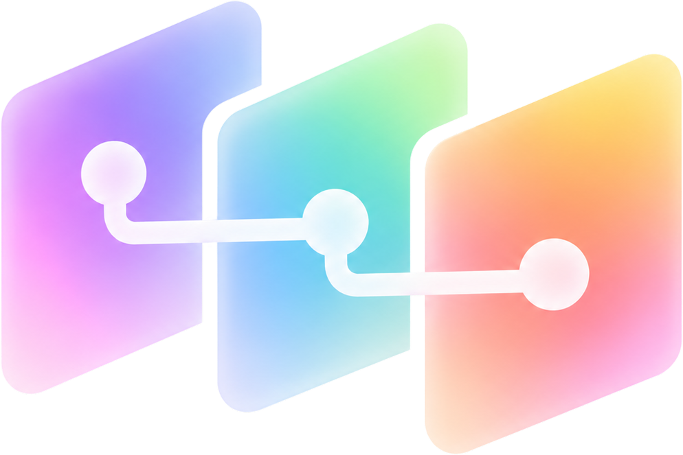

<p align="center">
  
</p>

# 有点想法 · 选题与灵感画布

面向设计项目与研究选题的 AI 画布。从一个粗想法出发，逐步细化问题，或通过跨域组合探索新方向；每张卡片保留来源和关联理由，让思路看得见来路。

> 本版本取消了项目内置的模型接口：没有服务端密钥、没有托管后端，也不读取 `.env`。所有 AI 生成都使用使用者自己在右上角「API 配置」里填写的接口，配置只保存在本机浏览器。
>
> 详细的安装、功能与配置说明见 **[使用说明.txt](使用说明.txt)**。

## 两种探索方式

| 模式 | 适合做什么 | 探索路径 |
| --- | --- | --- |
| 灵感模式 | 为一个题目发现不同跨度的组合与方案 | 题目 → 方向 → 方案 → 子方案 |
| 梳理模式 | 将已有想法收敛到具体问题 | 沿场景、人群、痛点细化；连接同类卡片提取交集 |

新建探索默认进入灵感模式。底部的模式按钮会恢复该模式上次打开的画布。

打开卡片右上角的「…」，选择「转到梳理模式」或「转到灵感模式」，即可用这张卡片作为新画布的中心。后续生成会读取转换时的原题、项目条件和上游卡片。再次从同一张卡转换会恢复已有进度。一个模式有多张画布时，可在底部选择画布。项目 JSON 和分享快照包含这些画布。

## 怎么用

1. 点击「新建探索」，写下一两句粗想法；已有项目可通过「打开项目」恢复或导入。
2. 点击卡片下方的加号继续生成，每次可选 3、6、10 张。梳理模式可从悬浮的维度卡片中选择场景、人群或痛点。
3. 用卡片左上角的编辑按钮修改标题、描述和关联理由，修改后的内容会影响下一次生成。
4. 选中卡片查看来路与直接下一级；收藏感兴趣的方向，再导出或分享。

示例画布使用预置卡片，打开示例不会调用模型；继续生成需要先在右上角配置 API。

## 当前功能

- **保留探索路径**：高亮完整上游和直接下一级；场景连线按类别分色，探索路径按场景、人物、痛点归类。
- **组合卡片**：梳理模式下，将连接点拖到另一张同类卡片，生成保留两侧条件的交集；可连接对象会高亮。
- **自动布局**：生成前显示扫光占位卡片，预留附近空间并疏散拥挤区域；拖动分支时，下级卡片一起移动；底部支持按主线一键整理和分支显隐。
- **收藏方向**：保存当前节点、全部上游路径和理由的快照。拉下顶部绳子查看，点击卡片翻转放大，点击星标取消收藏。
- **框选与输出**：支持多选、整体移动、删除，以及导出整个项目或选区；格式包括 JSON、Markdown、PNG，亦可打印为 PDF。
- **本地保存与分享**：自动保存在浏览器，分享链接打开后形成可独立编辑的项目副本。
- **界面与动效**：磨砂玻璃卡片、随演进深度渐淡的配色、液态玻璃工具栏；首页 Logo 自动循环，点击可暂停或继续，系统开启减少动态效果时显示静态 Logo。

### 画布操作

| 操作 | 方式 |
| --- | --- |
| 框选 | 拖动空白处；Shift 拖框加选 |
| 增减选择 | Shift 点击卡片 |
| 全选 / 清空选择 | ⌘ / Ctrl + A；Esc |
| 平移 | 触控板双指滑动；空格 + 拖动；鼠标中键拖动 |
| 缩放 | 触控板捏合；Command + 鼠标滚轮；底部缩放按钮 |
| 微调位置 | 方向键 |
| 删除所选节点 | Delete / Backspace；题目节点保留 |
| 撤销 / 重做 | ⌘ / Ctrl + Z；⌘ / Ctrl + Shift + Z |

撤销记录包含本次会话的 AI 生成、组合生成和节点删除；移动、整理、编辑与收藏不会占用记录。删除所选卡片时，未选中的后代和共享节点保留，失去上层的节点可作为独立想法继续使用。

### 保存与分享

项目存储在当前浏览器的 `localStorage`，服务端不保存画布。不同浏览器、不同设备的存储相互独立，可用 JSON 导入导出迁移；清理网站数据前请先导出。

分享链接包含项目内容快照，不包含 API Key。接收者获得独立副本，双方后续编辑互不影响。选区导出只包含选中的节点及内部连线；选区 JSON 可重新导入为新探索。

## 运行

需要 Node.js 22 或更新版本（`.nvmrc` 为 22）。项目没有运行时依赖，**不需要 `npm install`**。

```sh
npm start                 # 启动后访问 http://127.0.0.1:4178/
npm start -- --port 4180  # 换一个端口
npm run dev               # 修改文件后自动重启
```

也可以直接双击 `启动.command`（macOS）或 `启动.bat`（Windows），效果与 `npm start` 相同。

只打开 `app/index.html`（`file://`）无法运行，因为页面使用 ES 模块，必须通过本地服务访问。

## 配置 AI 接口

右上角的「API 配置」是唯一入口（首页右上角同样有入口）。填写：

| 字段 | 说明 |
| --- | --- |
| 模型服务 | DeepSeek 官方，或其他兼容 OpenAI Chat Completions 的服务 |
| API 地址 | 例如 `https://api.deepseek.com`；其他服务填其接口地址 |
| API Key | 在服务商后台创建；提交后只保存在本机浏览器 |
| 模型 ID | 可点「读取可用模型」自动拉取账号可用的模型 |

勾选「在这台浏览器记住配置」会写入 `localStorage`，下次打开自动连接；取消勾选则只在本次打开有效。「清除配置」会立即删除这条记录。

浏览器会直接从本机调用模型服务，因此服务必须允许跨域访问（CORS）。DeepSeek 官方接口已支持；其他服务若不支持，生成时会提示网络或跨域错误。

## 目录

| 路径 | 作用 |
| --- | --- |
| [app/index.html](app/index.html) | 页面入口 |
| [app/app.js](app/app.js) | 主程序：界面渲染、画布交互、生成流程、导出与分享 |
| [app/domain.js](app/domain.js) | 项目数据模型、校验、模式切换与画布布局 |
| [app/browser-model.js](app/browser-model.js) | 浏览器端 AI 客户端与本地配置保存 |
| [app/model-protocol.js](app/model-protocol.js) | 提示词、请求体与返回结果的校验 |
| [app/inspiration.js](app/inspiration.js) · [app/inspiration-rules.js](app/inspiration-rules.js) | 灵感模式的三阶段生成与校验规则 |
| [app/demo.js](app/demo.js) | 示例画布的预置卡片 |
| [app/styles.css](app/styles.css) · [app/interactions.css](app/interactions.css) · [app/liquid-glass-ui.css](app/liquid-glass-ui.css) | 样式与动效 |
| [server.mjs](server.mjs) | 仅提供静态文件服务的本地服务器 |
| [test/](test/) | Node 自带的测试用例 |

## 测试

```sh
npm test        # node --test
npm run check   # 语法检查
npm run validate
```

## 许可

[MIT](LICENSE)
