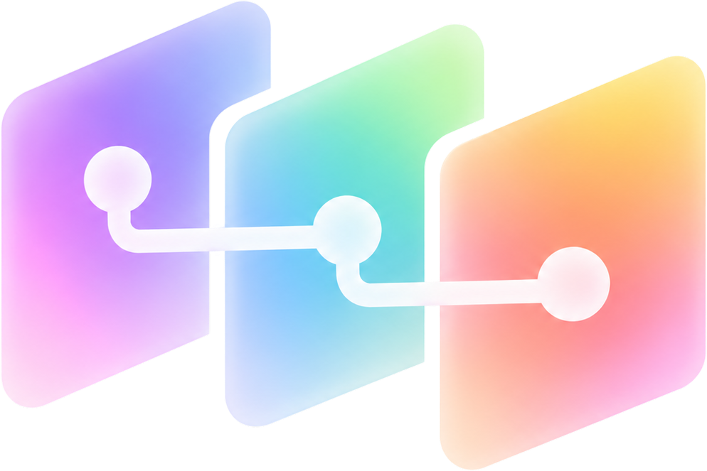
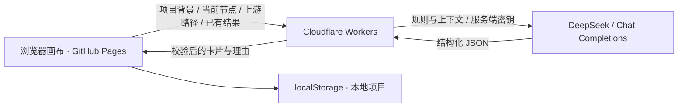

<p align="center">
  
</p>

# 有点想法 · 选题与灵感画布

[](https://github.com/Qiiii1/topic-explorer/actions/workflows/ci.yml)
[](https://github.com/Qiiii1/topic-explorer/actions/workflows/pages.yml)

面向设计项目与研究选题的 AI 画布。从一个粗想法出发，逐步细化问题，或通过跨域组合探索新方向；每张卡片保留来源和关联理由，让思路看得见来路。

**[在线使用](https://qiiii1.github.io/topic-explorer/) · [查看示例](https://qiiii1.github.io/topic-explorer/?demo=1)**

## 两种探索方式

| 模式 | 适合做什么 | 探索路径 |
| --- | --- | --- |
| 灵感模式 | 为一个题目发现不同跨度的组合与方案 | 题目 → 方向 → 方案 → 子方案 |
| 梳理模式 | 将已有想法收敛到具体问题 | 沿场景、人群、痛点细化；连接同类卡片提取交集 |

新建探索默认进入灵感模式，底部胶囊可切换模式。两种模式拥有独立画布，保留各自的节点、连线、位置、收藏与生成数量；首次切换时从最初题目开始，再次切换则恢复已有内容。整个项目的 JSON 导出和分享快照会包含两份画布。

## 怎么用

1. 点击「新建探索」，写下一两句粗想法；已有项目可通过「打开项目」恢复或导入。
2. 点击卡片下方的加号继续生成，每次可选 3、6、10 张。梳理模式可从悬浮的维度卡片中选择场景、人群或痛点。
3. 用卡片左上角的编辑按钮修改标题、描述和关联理由，修改后的内容会影响下一次生成。
4. 选中卡片查看来路与直接下一级；收藏感兴趣的方向，再导出或分享。

示例画布使用预置卡片，打开示例不会调用模型；继续生成需要真实 AI 服务。

## 当前功能

- **保留探索路径**：高亮完整上游和直接下一级；场景连线按类别分色，探索路径按场景、人物、痛点归类。
- **组合卡片**：梳理模式下，将连接点拖到另一张同类卡片，生成保留两侧条件的交集；可连接对象会高亮。
- **自动布局**：生成前显示扫光占位卡片，预留附近空间并疏散拥挤区域；拖动分支时，下级卡片一起移动；底部支持按主线一键整理和分支显隐。
- **收藏方向**：保存当前节点、全部上游路径和理由的快照。拉下顶部绳子查看，点击卡片翻转放大，点击星标取消收藏。
- **框选与输出**：支持多选、整体移动、删除，以及导出整个项目或选区；格式包括 JSON、Markdown、PNG，亦可打印为 PDF。
- **本地保存与分享**：自动保存在浏览器，分享链接打开后形成可独立编辑的项目副本。
- **界面与动效**：磨砂玻璃卡片、随演进深度渐淡的配色、液态玻璃工具栏；首页 Logo 自动循环，点击可暂停或继续，系统开启减少动态效果时显示静态 Logo。

### 画布操作

| 操作 | 方式 |
| --- | --- |
| 框选 | 拖动空白处；Shift 拖框加选 |
| 增减选择 | Shift 点击卡片 |
| 全选 / 清空选择 | ⌘ / Ctrl + A；Esc |
| 平移 | 触控板双指滑动；空格 + 拖动；鼠标中键拖动 |
| 缩放 | 触控板捏合；Command + 鼠标滚轮；底部缩放按钮 |
| 微调位置 | 方向键 |
| 删除所选节点 | Delete / Backspace；题目节点保留 |
| 撤销 / 重做 | ⌘ / Ctrl + Z；⌘ / Ctrl + Shift + Z |

撤销记录包含本次会话的 AI 生成、组合生成和节点删除；移动、整理、编辑与收藏不会占用记录。删除所选卡片时，未选中的后代和共享节点保留，失去上层的节点可作为独立想法继续使用。

### 保存与分享

项目存储在当前浏览器的 `localStorage`，服务端不保存画布。线上网页、本地服务和不同浏览器的存储相互独立，可用 JSON 导入导出迁移；清理网站数据前请先导出。

分享链接包含项目内容快照，不包含模型密钥。接收者获得独立副本，双方后续编辑互不影响。选区导出只包含选中的节点及内部连线；选区 JSON 可重新导入为新探索。

## 本地运行

需要 Node.js 22 或更新版本，推荐使用 `.nvmrc` 指定的 Node 22。

```sh
git clone https://github.com/Qiiii1/topic-explorer.git
cd topic-explorer
npm ci
npm start
```

打开 **http://127.0.0.1:4178/**。请通过本地服务访问，直接双击 HTML 文件不能正常运行模型接口和模块。

指定其他端口：

```sh
npm start -- --port 4180
```

### 配置本地 AI

推荐使用环境变量：

```sh
cp .env.example .env
```

编辑 `.env`，填写模型 ID 和 API Key，再启动：

```sh
npm run start:env
```

| 变量 | 用途 | 默认值 |
| --- | --- | --- |
| `PORT` | 本地服务端口 | `4178` |
| `TOPIC_AI_BASE_URL` | Chat Completions 服务基础地址 | `https://api.deepseek.com` |
| `TOPIC_AI_MODEL` | 服务商提供的模型 ID | 空 |
| `TOPIC_AI_API_KEY` | 模型服务密钥 | 空 |

服务需要兼容 Chat Completions 并支持 JSON 输出。基础地址不用填写 `/chat/completions` 后缀。

本地未配置模型时，首次生成会弹出模型设置；右上角不再显示 AI 配置入口。通过页面填写的密钥只保存在本地 Node 服务进程内存，关闭后清除；`.env` 中的配置由使用者自行保存，该文件已被 Git 忽略。`npm start` 读取系统环境变量，`npm run start:env` 额外读取 `.env`。

## 技术路径与部署

前端使用原生 JavaScript、DOM 卡片和 SVG 连线；线上网页由 GitHub Pages 托管，Cloudflare Workers 转发 AI 请求并校验结果。模型调用支持 DeepSeek 等兼容 Chat Completions 的服务。



每次生成会携带题目、明确条件、当前卡片、上游路径与已有结果。梳理模式按目标维度细化或提取交集；灵感模式按阶段继承方向核心、约束变化并减少重复。生成失败或取消后恢复预留布局，已有卡片保留。

### 发布到 GitHub Pages + Cloudflare

完整步骤见 **[Cloudflare 部署说明](cloudflare/README.md)**。

| 配置 | 放在哪里 | 用途 |
| --- | --- | --- |
| `TOPIC_AI_API_KEY` | Cloudflare **Secret** | 模型密钥，仅服务端读取 |
| `TOPIC_AI_BASE_URL`、`TOPIC_AI_MODEL` | Cloudflare 变量 | 模型接口与模型 ID |
| `TOPIC_WEB_ORIGINS` | Cloudflare 变量 | 允许的网页来源，如 `https://qiiii1.github.io` |
| `TOPIC_API_BASE_URL` | GitHub Actions 仓库 **Variable** | 公开的 Worker 域名，不带 `/api` 路径 |

在线访客直接使用托管的 AI 接口，页面不提供站点密钥配置入口。

```sh
npm run cf:deploy
npm run build:pages
```

先部署 Worker 并配置模型，再设置公开的后端地址、发布网页。推送 `main` 后，[Publish website](https://github.com/Qiiii1/topic-explorer/actions/workflows/pages.yml) 会自动检查、构建并发布。GitHub Pages 使用 GitHub Actions 作为发布来源，不需要将模型密钥放入 GitHub。

`build:pages` 输出 `dist/`，只复制网页资源并注入公开的后端地址，不打包服务端密钥。CSS 和 JavaScript 模块会附带统一的内容版本标识，避免发布后继续加载旧资源。

## 开发与检查

| 命令 | 用途 |
| --- | --- |
| `npm run dev` | 监听本地服务代码并自动重启 |
| `npm run validate` | 语法检查与行为测试，不调用真实模型 |
| `npm run cf:dev` | 在本机 `4183` 端口运行 Worker |
| `npm run cf:check` | 检查 Worker 打包，不上传 |
| `npm run build:pages` | 构建 GitHub Pages 网页 |
| `npm pack` | 生成源码包，不发布到 npm |

[GitHub Actions](https://github.com/Qiiii1/topic-explorer/actions) 在 Node 22、24 上检查语法、运行测试、构建网页、检查 Worker 打包和源码包内容。

主要代码：

| 文件 | 职责 |
| --- | --- |
| [app/app.js](app/app.js) | 页面、画布交互、收藏与导出 |
| [app/domain.js](app/domain.js) | 节点关系、布局、分支与项目数据 |
| [app/inspiration.js](app/inspiration.js)、[app/inspiration-rules.js](app/inspiration-rules.js) | 灵感阶段协议与规则快照 |
| [app/model-protocol.js](app/model-protocol.js) | 模型请求构造与结果校验 |
| [app/home-logo.js](app/home-logo.js) | 首页 SVG Logo 循环动画 |
| [cloudflare/worker.js](cloudflare/worker.js) | 托管 AI 接口 |
| [scripts/build-pages.mjs](scripts/build-pages.mjs) | 网页构建、后端地址注入与资源版本 |

液态玻璃组件随项目本地打包，许可见 [liquid-glass-web / MIT](app/vendor/liquid-glass/LICENSE.txt)。图标来源包括 Figma 原稿和 [Tabler Icons](https://tabler.io/icons)。

## 当前范围

`main` 尚未接入账号登录、每账号 30 次免费额度、云同步或多人实时协作。工具用于探索和整理待调研的想法，不提供论文检索或学术创新性判定。

## License

MIT © 2026 Qiiii1
